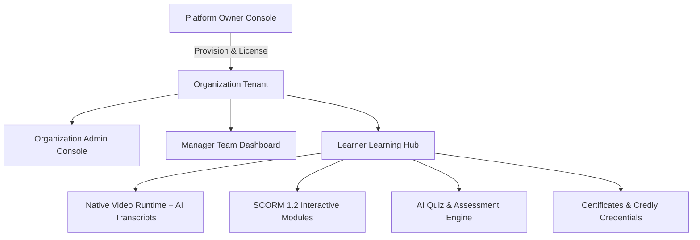

# LearnHub Enterprise LMS Platform

[](https://learnhub.example.com)
[](https://nextjs.org)
[](https://www.typescriptlang.org/)
[](https://www.prisma.io/)
[](#pricing--plans)

LearnHub is a next-generation, multi-tenant Learning Management System (LMS) designed for commercial enterprises, training providers, and modern organizations. Built with a modular monolith architecture using **Next.js 15**, **React 19**, **Prisma**, and **PostgreSQL**, LearnHub provides a seamless experience for Learners, Managers, Organization Admins, and Platform Owners.

---

## 🌟 Visual Preview & Platform Overview



### 📸 Product Interface Visuals

```html
<div align="center">
  
  <p><em>Figure 1: LearnHub Learner Experience with AI Transcript Search and Video Playback.</em></p>
</div>
```

### 🎬 Product Video Walkthrough

```html
<div align="center">
  <video width="850" controls poster="https://images.unsplash.com/photo-1522071820081-009f0129c71c?w=1200&auto=format&fit=crop&q=80">
    <source src="https://commondatastorage.googleapis.com/gtv-videos-bucket/sample/BigBuckBunny.mp4" type="video/mp4">
    Your browser does not support the video tag.
  </video>
  <p><em>Video 1: LearnHub Platform Tour — AI-Powered Learning & SCORM Runtime (3 mins).</em></p>
</div>
```

---

## 🚀 Key Features & AI Superpowers

### 🤖 AI-Powered Capabilities
- **AI Interactive Transcript Search**: Instant timestamped jump-to-cue across native video lessons based on natural language queries.
- **AI Automated Quiz Generator**: Auto-generate multiple choice knowledge checks directly from video transcripts or SCORM lesson content.
- **AI Automated Subtitles & Closed Captions**: Multi-language AI subtitle synthesis and closed-captioning for high accessibility.
- **AI Learning Path Recommendations**: Smart category and tag matching algorithms that recommend relevant courses based on learner history.
- **AI Skill Gap & Analytics Engine**: Real-time team capability assessment identifying knowledge gaps and overdue risks for managers.

### 🎥 Native Video & Media Runtime
- **HLS Streaming & Adaptive Bitrate**: High-definition video delivery powered by Mux media streaming integration.
- **Interactive Player Controls**: Resume playback from exact timestamp, playback rate controls, chapter bookmarks, and automatic progress sync.
- **External Embed Support**: Seamless integration for YouTube, Vimeo, and custom enterprise video streams.

### 📦 SCORM 1.2 & Standards Runtime
- **Clean Isolated Sandbox**: Secure iframe client runtime with full CMI bridge implementation (`cmi.core.lesson_status`, `score.raw`, `session_time`).
- **Zip Package Extraction**: Automatic package extraction and asset management.

### 🏢 Enterprise Multitenancy & Security
- **Organization Isolation**: Complete tenant data separation at standard database level with organization-scoped routing (`/org/[slug]`).
- **Custom Tenant Branding**: Configurable primary and accent colors, custom organization logo, and enrollment policies.
- **Role-Based Access Control**: Strict boundaries between Platform Owners, Organization Admins, Managers, and Learners.

---

## 💰 Pricing & Plans (All Prices in USD $)

All LearnHub plans are billed transparently in **US Dollars ($)** with no hidden transaction fees or per-currency conversions.

| Plan | Price (USD $) | Included Learners | Key Features |
| :--- | :--- | :--- | :--- |
| **Starter** | **$19 / user / month** | Up to 25 Users | Native Video Player, Basic SCORM 1.2, Certificates, Standard Email Support |
| **Professional** | **$499 / month** | Up to 100 Users | Everything in Starter + AI Transcript Search, AI Quiz Generator, Custom Branding |
| **Enterprise** | **$1,499 / month** | Up to 500 Users (+$2/user beyond) | Everything in Pro + Global Library Access, AI Analytics Engine, Manager Dashboard, Dedicated Support |
| **AI Content Pack Add-on** | **$99 / month** | Unlimited Tenants | Automated AI Subtitling, AI Voice Generation, AI Assessment Engine |

> *Note: All transactions, invoices, and billing agreements are strictly processed in **USD ($)**.*

---

## 📚 Comprehensive Documentation Directory

Explore our detailed user guides and commercial marketing materials:

### 📖 User Guides
- [Learner User Guide](docs/user-guides/learner-guide.md): Complete guide for learners navigating courses, native video player, AI transcript search, SCORM runtime, and certificates.
- [Organization Admin Guide](docs/user-guides/admin-guide.md): Step-by-step instructions for tenant branding, user lifecycle management, course authoring, AI quiz generation, and reports.
- [Manager User Guide](docs/user-guides/manager-guide.md): Guide for team leads monitoring progress, viewing direct report completion, AI gap analysis, and handling overdue escalations.
- [Platform Owner Guide](docs/user-guides/platform-owner-guide.md): Operational guide for multi-tenant provisioning, global course library curation, and system-wide metrics.

### 📢 Marketing & Sales Materials
- [Product Overview](docs/marketing/product-overview.md): Commercial product showcase highlighting enterprise multi-tenancy, AI capabilities, and video playback features.
- [Pricing & Plans Breakdown](docs/marketing/pricing-and-plans.md): Detailed USD ($) pricing matrix, ROI calculator, feature comparison, and enterprise add-ons.
- [AI & Video Feature Sheet](docs/marketing/feature-sheets-ai-and-video.md): Deep-dive technical feature specification covering the Mux video engine, AI transcript search, and SCORM runtime.
- [Executive Sales Deck Summary](docs/marketing/sales-deck-summary.md): 12-slide executive presentation outline, battlecard vs legacy LMS platforms, and demo video script.

---

## 🛠️ Quickstart & Development

### Prerequisites
- Node.js 20+
- PostgreSQL 16+
- npm or pnpm

### Installation

```bash
# Clone the repository
git clone https://github.com/learnhub/learnhub.git
cd LearnHub

# Install dependencies
npm install

# Set up environment variables
cp .env.example .env

# Run database migrations and seed data
npx prisma migrate dev
npx prisma db seed

# Launch development server
npm run dev
```

Open [http://localhost:3000](http://localhost:3000) in your browser to view LearnHub.

---

## 📄 License & Commercial Rights

Copyright © 2026 LearnHub Inc. All rights reserved. Billed and managed in USD ($).
