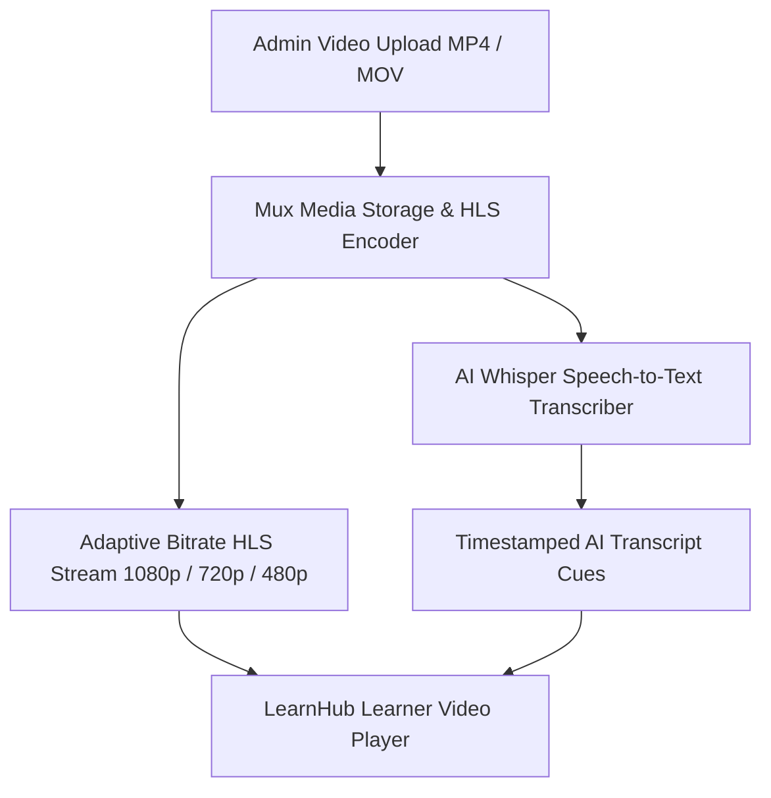

# LearnHub Technical Feature Sheet: AI Superpowers & Native Video Engine

LearnHub combines a modern, provider-backed native video infrastructure with state-of-the-art Artificial Intelligence to transform raw training videos into interactive, searchable, self-evaluating learning modules.

---

## 🎥 1. High-Performance Native Video Architecture

LearnHub's native video architecture is built for high reliability, low-latency playback, and seamless cross-platform device delivery.



```html
<div align="center">
  
  <p><em>Figure 1: High-Definition HLS Video Delivery with Synchronized AI Transcript Search.</em></p>
</div>
```

### Key Technical Specs:
- **Streaming Protocol**: HTTP Live Streaming (HLS) with fallback MP4 progressive download.
- **Transcoding Profiles**: Adaptive bitrate encoding (1080p, 720p, 480p, 360p) for low-bandwidth mobile environments.
- **Progress Tracking**: Automatic heartbeats posted every 15 seconds to sync exact video timestamp to `VideoLessonProgress`.
- **Chapter Bookmarking**: Structured chapter cues stored in Prisma schema with instant UI jump controls.

```html
<div align="center">
  <video width="800" controls poster="https://images.unsplash.com/photo-1522071820081-009f0129c71c?w=1000&auto=format&fit=crop&q=80">
    <source src="https://commondatastorage.googleapis.com/gtv-videos-bucket/sample/WeAreGoingOnBullrun.mp4" type="video/mp4">
    Your browser does not support the video tag.
  </video>
  <p><em>Video 1: Video Playback & Timestamped Chapter Seeking Demo (1 min).</em></p>
</div>
```

---

## 🤖 2. AI Superpowers Suite

### Feature A: AI Interactive Transcript Search
- **Instant Natural Language Query**: Learners can type words like "password security" or "compliance reporting" directly into the transcript search bar.
- **Precision Seeking**: Clicking any search result moves the video player directly to the exact millisecond.

```html
<div align="center">
  
  <p><em>Figure 2: Interactive AI Transcript Search highlighting keyword occurrences.</em></p>
</div>
```

### Feature B: AI Automated Quiz Generator
- **Transcripts-to-Assessments**: The AI engine analyzes the transcript of a video lesson and generates 3-5 multiple-choice questions per module.
- **Distractor Rationale**: AI automatically generates realistic incorrect choices and detailed explanations for why each answer is correct.

```typescript
// Sample AI Quiz Generation Schema Output
interface AIGeneratedQuestion {
  questionText: string;
  options: {
    id: string;
    text: string;
    isCorrect: boolean;
    explanation: string;
  }[];
}
```

### Feature C: AI Automated Subtitling & Captioning
- Multi-language VTT caption file generation (English, Spanish, French, German, Japanese).
- Synchronized WebVTT text track rendering directly inside HTML5/React video elements.

### Feature D: AI Team Skill Gap Analytics
- Aggregates learner quiz failure patterns across teams.
- Recommends specific video chapters or remedial refresher modules to managers.

---

## 🔒 Enterprise Media Security & Storage

- **Signed Playback URLs**: Video URLs expire after 60 minutes to prevent unauthorized video scraping or external hotlinking.
- **Cloudflare R2 / AWS S3 Integration**: High-durability cloud storage for raw assets and SCORM archives.
- **Production Storage Isolation**: Strict organization key prefixing (`/orgs/{orgId}/videos/{videoId}`) ensures complete data separation.

For commercial subscription information in USD ($), read the [Pricing & Plans Breakdown](pricing-and-plans.md). Return to [README.md](../../README.md) for full workspace navigation.
