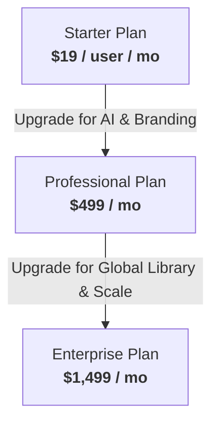

# LearnHub Pricing & Subscription Plans (Priced in USD $)

LearnHub provides simple, transparent pricing billed in **US Dollars ($)**. No hidden per-course creation fees, no setup surcharges, and zero currency conversion fees.

---

## 💵 Subscription Tier Matrix

All plans are billed monthly or annually (with a 20% discount on annual commitments). All dollar values are strictly in **USD ($)**.



```html
<div align="center">
  
  <p><em>Figure 1: LearnHub Dollar Subscription Tiers & Feature Matrix.</em></p>
</div>
```

| Feature / Capability | Starter ($19/user/mo) | Professional ($499/mo) | Enterprise ($1,499/mo) |
| :--- | :---: | :---: | :---: |
| **Included Learner Capacity** | Per User (1-25) | Up to 100 Users | Up to 500 Users |
| **Additional Learner Rate** | $19 / user / mo | $5 / user / mo | $2 / user / mo |
| **Native Video HLS Player** | ✅ | ✅ | ✅ |
| **SCORM 1.2 Runtime** | ✅ | ✅ | ✅ |
| **AI Interactive Transcript Search** | ❌ | ✅ | ✅ |
| **AI Quiz Generator** | ❌ | ✅ | ✅ |
| **Custom Tenant White-Labeling** | Basic | Full Colors & Logo | Custom Subdomains & CSS |
| **Global Library Master Copy** | ❌ | ❌ | ✅ |
| **Manager Team Console** | ❌ | ✅ | ✅ |
| **Compliance Reports & Audit Logs** | Standard | Advanced | Custom CSV & API |
| **Support SLA** | Email (24h) | Priority Email (4h) | Dedicated Account Manager |

---

## 🤖 AI Superpower Add-On Packages (Priced in USD $)

Enhance your subscription with specialized AI capability packs:

- **AI Content Creator Pack**: **$99 / month** per organization.
  - Automated video transcript extraction.
  - Unlimited AI-generated multiple-choice quiz creation.
  - Multi-language AI closed captioning.

- **AI Copilot & Personal Learning Tutor**: **$199 / month** per organization.
  - 24/7 AI conversational learning assistant for learners.
  - Automated AI team skill gap detection for managers.
  - Automated personalized course recommendations.

---

## 📈 ROI Calculator & Financial Impact (USD $)

Investing in LearnHub yields rapid financial returns compared to traditional in-person training or legacy LMS costs.

```html
<div align="center">
  
  <p><em>Figure 2: Customer Cost-Savings Analysis over 12 Months.</em></p>
</div>
```

### 💡 Example Financial Case Study (250-Employee Company):

- **Legacy LMS & In-Person Instructor Costs**: ~$65,000 / year
- **LearnHub Enterprise Plan ($1,499/mo)**: $17,988 / year
- **Net Annual Savings**: **$47,012 USD ($)** per year
- **Estimated ROI**: **261% return in Year 1**

---

## 💳 Payment Methods & Invoicing

We accept payment in **USD ($)** via:
1. All Major Credit Cards (Visa, MasterCard, American Express).
2. Automated ACH Corporate Bank Transfers.
3. Annual Enterprise Wire Transfers with custom PO support.

To explore product details, see the [Product Overview](product-overview.md) or return to the main [README.md](../../README.md).
