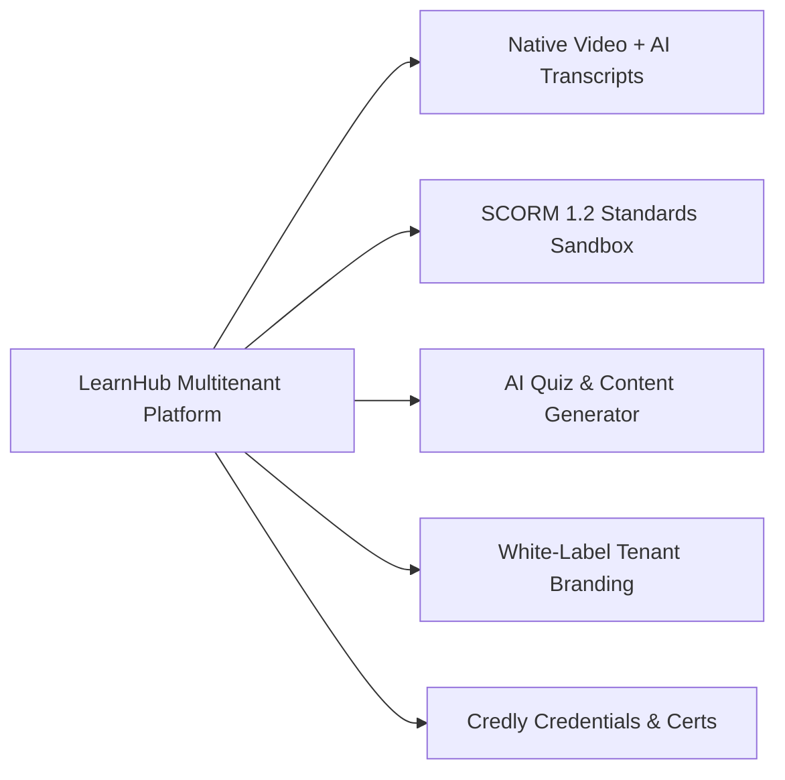

# LearnHub Product Overview: Next-Gen AI-Powered Enterprise LMS

LearnHub is an enterprise-grade, multi-tenant Learning Management System (LMS) engineered to revolutionize workforce training, partner certification, and compliance education. Combining high-definition native video streaming, AI-powered interactive transcript search, SCORM 1.2 runtime compatibility, and custom white-label branding, LearnHub enables businesses to deliver engaging learning experiences at scale.

---

## 🚀 Why Choose LearnHub?

Traditional LMS platforms are clunky, slow, and expensive. LearnHub delivers a modern, learner-first experience inspired by leading commercial course platforms, backed by institutional enterprise controls.



```html
<div align="center">
  
  <p><em>Figure 1: LearnHub Learner Portal featuring AI Transcript Search and HLS Video Streaming.</em></p>
</div>
```

---

## 🌟 Core Product Pillars & AI Superpowers

### 🤖 1. AI Content & Study Superpowers
- **AI Interactive Transcript Search**: Search spoken words across any native video lesson and jump directly to the video timestamp.
- **AI Auto-Quiz Generator**: Create robust multiple-choice knowledge checks from uploaded video content or SCORM documents in seconds.
- **AI Automated Captions & Translation**: Generate multi-language closed captions automatically for global workforces.
- **AI Skill Gap Analytics**: Receive automated recommendations and risk alerts when teams demonstrate knowledge gaps.

### 🎥 2. Next-Gen Native Video Engine
- **HLS Adaptive Bitrate Delivery**: Ultra-smooth video playback powered by Mux video streaming infrastructure.
- **Interactive Chaptering**: Easy navigation across video sections.
- **Timestamped Resume**: Automatically pick up learning exactly where left off across desktop and mobile devices.

### 📦 3. SCORM 1.2 Enterprise Runtime
- Full backward compatibility with legacy SCORM packages (Articulate Storyline, Adobe Captivate, iSpring).
- Isolated sandbox iframe runtime with real-time CMI status tracking.

### 🎨 4. Multi-Tenant White-Labeling
- Dedicated tenant URLs (`/org/[slug]`).
- Customizable logo, primary color, accent color, and enrollment policies per tenant organization.

---

## 🎬 Video Product Walkthrough

```html
<div align="center">
  <video width="850" controls poster="https://images.unsplash.com/photo-1522071820081-009f0129c71c?w=1200&auto=format&fit=crop&q=80">
    <source src="https://commondatastorage.googleapis.com/gtv-videos-bucket/sample/SubaruOutbackOnTheGrid.mp4" type="video/mp4">
    Your browser does not support the video tag.
  </video>
  <p><em>Video 1: LearnHub Product Overview — Native Video, AI Tools, and SCORM Runtime (3 mins).</em></p>
</div>
```

---

## 💰 Commercial Pricing Summary (All Prices in USD $)

LearnHub offers straightforward, predictable pricing in **US Dollars ($)**.

```html
<div align="center">
  
  <p><em>Figure 2: Transparent Monthly Subscription Options in US Dollars ($).</em></p>
</div>
```

- **Starter Plan**: **$19 / user / month** (up to 25 learners)
- **Professional Plan**: **$499 / month** (up to 100 learners)
- **Enterprise Plan**: **$1,499 / month** (up to 500 learners + $2/user beyond)

For full pricing details, view [Pricing & Plans Breakdown](pricing-and-plans.md). To see technical feature details, explore the [AI & Video Feature Sheet](feature-sheets-ai-and-video.md).
