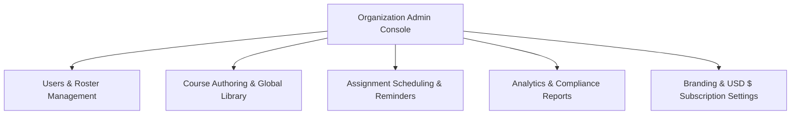

# LearnHub Organization Admin Guide

As an **Organization Admin**, you control your company's dedicated LearnHub tenant. This guide covers user onboarding, branding customization, course creation, AI-powered content generation, SCORM package management, course assignments, dollar billing configuration, and compliance reporting.

---

## 🛠️ Admin Navigation & Console Overview

Access your admin workspace at `/org/[slug]/admin`. The console is split into targeted management modules:



---

## 🎨 Tenant Branding & Settings

Customize LearnHub to match your enterprise brand identity under **Admin > Settings**.

```html
<div align="center">
  
  <p><em>Figure 1: Organization Branding Settings & Color Customization.</em></p>
</div>
```

### Configurable Attributes:
- **Organization Name**: Your company's display name across all portals and emails.
- **Primary Color**: Hex code (e.g., `#235bdb`) for navigation headers and primary buttons.
- **Accent Color**: Hex code (e.g., `#12b8a6`) for tags and progress highlights.
- **Logo URL**: High-resolution PNG/SVG logo used in the header and issued certificates.
- **Enrollment Policy**: Choose between **Assignment Only** or **Assignment + Learner Self-Enrollment**.

---

## 👥 User Lifecycle & CSV Bulk Import

Manage employee access and team structures under **Admin > Users**.

```html
<div align="center">
  
  <p><em>Figure 2: User Roster Management and CSV Upload Interface.</em></p>
</div>
```

### CSV Bulk Import Workflow:
1. Navigate to `/org/[slug]/admin/users/import`.
2. Download the standard CSV template containing columns: `email, firstName, lastName, role, managerEmail`.
3. Upload your completed CSV. LearnHub automatically validates user rows, detects duplicate emails, establishes manager-employee hierarchies, and dispatches activation invites.

---

## 📚 Course Authoring & AI Superpowers

LearnHub provides powerful tools to create native video courses, import SCORM packages, or copy courses from the Global Library.

```html
<div align="center">
  <video width="800" controls poster="https://images.unsplash.com/photo-1531403009284-440f080d1e12?w=1000&auto=format&fit=crop&q=80">
    <source src="https://commondatastorage.googleapis.com/gtv-videos-bucket/sample/ForBiggerFun.mp4" type="video/mp4">
    Your browser does not support the video tag.
  </video>
  <p><em>Video 1: Native Video Upload & AI Quiz Generator Demo (2 mins).</em></p>
</div>
```

### 🤖 AI Content Authoring Features

#### 1. AI Video Lesson Studio
- Open **Admin > Video Content** and choose a native video course.
- Create a lesson draft using its title, module, and duration; the lesson slug is created automatically.
- Enter the learning goal, audience, tone, and target length in **AI Video Studio** to generate objectives, narration, scene descriptions, and a text-to-video prompt.
- Review the package, save the lesson, use the prompt with your chosen video-generation service, then upload the rendered video to the lesson through Mux.
- Configure the server-side `OPENAI_API_KEY` to enable AI authoring. Generated drafts are not rendered video files; Mux upload remains a separate step.

#### 2. AI Automatic Transcript & Subtitle Synthesis
- Upload native MP4/MOV video files.
- Click **Generate AI Transcript**. LearnHub automatically processes audio into timestamped cues and multi-language closed captions.

#### 3. AI Quiz Generator
- Select any course module or video transcript.
- Click **Auto-Generate AI Quiz**. The AI engine creates multiple-choice knowledge check questions with correct answer rationale and distraction options.

#### 4. Global Library Copy Workflow
- Browse curated enterprise courses in the platform's Global Library.
- Click **Copy to Organization Catalog**. The course becomes a tenant-owned copy that can be tailored without affecting the original master.

---

## 📦 SCORM 1.2 Package Management

1. Under **Admin > Courses > New Course**, select **SCORM 1.2 Package**.
2. Upload your `.zip` archive (containing `imsmanifest.xml`).
3. Click **Validate Package**. LearnHub validates the manifest root and extracts content files into secure cloud storage.
4. Preview the package in the sandbox player before publishing.

---

## 🎯 Course Assignments & Automated Escalations

Assign courses to individual learners, departments, or entire organizations under **Admin > Assignments**.

```html
<div align="center">
  
  <p><em>Figure 3: Bulk Assignment Scheduling with Due Dates and Automated Reminders.</em></p>
</div>
```

- **Due Dates & Soft Targets**: Set mandatory compliance due dates.
- **Automated Email Reminders**: Schedule automated digest notifications 7 days, 3 days, and 1 day prior to due date.
- **Manager Overdue Escalations**: Automatically notify team managers when direct reports miss completion deadlines.

---

## 💳 Billing & Subscription Management (USD $)

Manage your organization's subscription tier and billing invoices under **Admin > Settings > Billing**. All plans are priced strictly in **US Dollars ($)**.

| Tier | Monthly Rate (USD $) | User Capacity | Features |
| :--- | :--- | :--- | :--- |
| **Professional** | **$499 / mo** | Up to 100 Users | Full Native Video + SCORM, AI Transcript Search, Custom Branding |
| **Enterprise** | **$1,499 / mo** | Up to 500 Users | Everything in Pro + Global Library Copy, AI Analytics, Dedicated Support |
| **Additional Users** | **$2.00 / user / mo** | Custom | Scale seamlessly beyond plan limits |

> *All payments and invoicing occur in **USD ($)** via Credit Card or ACH corporate transfer.*

---

## 📊 Analytics & Compliance Reports

Track organizational progress and pass rates under **Admin > Reports**.

- **Completion Rate Heatmaps**: View completion breakdown by department.
- **AI Gap Analysis**: Review topics where learners frequently fail knowledge checks.
- **CSV Data Export**: Export raw completion records for compliance audits.

For platform overview and user documentation, refer back to the main [README.md](../../README.md) or check the [Learner Guide](learner-guide.md).
