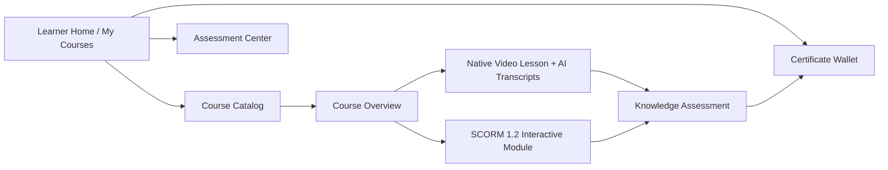

# LearnHub Learner User Guide

Welcome to LearnHub! This guide walks you through your personal learning portal, from discovering assigned courses to taking native video and SCORM lessons, utilizing AI-powered study aids, completing knowledge assessments, and sharing earned certificates.

---

## 🧭 Navigation Overview

When you sign into your organization's learning portal at `/org/[your-company-slug]/learn`, you will see a clean, intuitive navigation bar tailored to your learning journey.



### Key Areas:
1. **My Courses (`/org/[slug]/learn`)**: View your enrolled and assigned courses, current completion percentages, due dates, and quick resume buttons.
2. **Catalog (`/org/[slug]/learn/catalog`)**: Browse company-approved courses available for self-enrollment.
3. **Assessments (`/org/[slug]/learn/assessments`)**: View pending quizzes, past test attempts, and detailed feedback breakdown.
4. **Certificates (`/org/[slug]/certificates`)**: Access, download, print, and share your official completion certificates and Credly credentials.

---

## 🎥 Native Video Learning Experience & AI Superpowers

LearnHub provides a high-definition, interactive video player designed for deep learning engagement.

```html
<div align="center">
  
  <p><em>Figure 1: LearnHub Native Video Player featuring AI Interactive Transcript Search.</em></p>
</div>
```

### 🤖 AI Interactive Transcript Search
- **Instant Search**: Type any keyword or topic into the **AI Transcript Search Box** beside the video player.
- **Timestamp Jumping**: Click any highlighted search result to immediately jump the video player to the exact second where the topic is discussed.
- **AI Summary & Key Takeaways**: Click the **AI Summary** button to view automated key bullet points extracted from the lesson's audio.

### 🎬 Interactive Video Features
- **Automatic Resume**: When you return to a lesson, LearnHub automatically picks up at the exact second you left off.
- **Speed Controls**: Select playback speeds from `0.75x` up to `2.0x`.
- **Chapter Markers**: Easily jump between major topics using the clickable chapter sidebar.

```html
<div align="center">
  <video width="800" controls poster="https://images.unsplash.com/photo-1522071820081-009f0129c71c?w=1000&auto=format&fit=crop&q=80">
    <source src="https://commondatastorage.googleapis.com/gtv-videos-bucket/sample/ForBiggerBlazes.mp4" type="video/mp4">
    Your browser does not support the video tag.
  </video>
  <p><em>Video 1: Walkthrough of AI Transcript Search & Video Playback Controls (1 min).</em></p>
</div>
```

---

## 📦 SCORM 1.2 Interactive Modules

For compliance, interactive simulations, and storyline packages, LearnHub hosts an isolated SCORM 1.2 runtime sandbox.

1. Click **Launch Course** on any SCORM package lesson.
2. Complete interactive slides, drag-and-drop exercises, and module questions.
3. LearnHub automatically captures your `lesson_status` (`passed`, `completed`, `failed`) and raw score upon completion.

---

## 📝 Taking Assessments & AI Feedback

After completing course materials, you may be presented with a Knowledge Check assessment.

```html
<div align="center">
  
  <p><em>Figure 2: Assessment submission view with AI instant grading feedback.</em></p>
</div>
```

- **Instant AI Feedback**: Receive detailed explanations for why answers were correct or incorrect.
- **Attempt Tracking**: Review your attempt history and target specific areas for improvement before re-taking quizzes.

---

## 🎓 Certificates & Credly Badging

Upon achieving 100% course completion and passing required assessments, LearnHub automatically issues an official Certificate of Completion.

```html
<div align="center">
  
  <p><em>Figure 3: LearnHub Verified Digital Certificate with QR verification code.</em></p>
</div>
```

### Features:
- **Download HTML / PDF**: Print or download a high-resolution version of your certificate.
- **Public Verification Link**: Share your unique verification URL (`/certificates/[verificationCode]`) with external employers or auditors.
- **Credly Integration**: Export your achievement directly to your LinkedIn profile and Credly digital badge wallet.

> *Need assistance? Contact your organization administrator or consult the [README.md](README.md) for platform support.*
