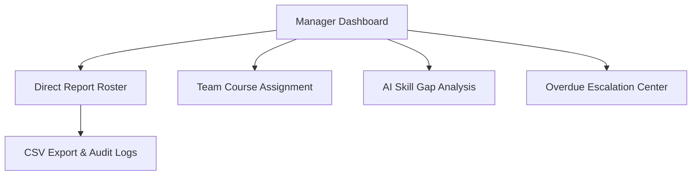

# LearnHub Manager User Guide

As a **Team Manager**, LearnHub gives you direct visibility into your team's learning progress, compliance status, skill development, and course completions. This guide covers how to monitor direct reports, assign training, analyze AI skill gap insights, and manage overdue escalations.

---

## 📊 Manager Dashboard Overview

Access your team management console at `/org/[slug]/manager`.



```html
<div align="center">
  
  <p><em>Figure 1: LearnHub Team Progress Overview and Real-Time Completion Tracker.</em></p>
</div>
```

---

## 👥 Monitoring Direct Reports

The **Direct Report Roster** displays all employees assigned to you in the organization's org chart.

### Metrics Tracked per Employee:
- **Enrolled Courses**: Total active training courses.
- **Completion Rate (%)**: Percentage of assigned modules finished.
- **Average Quiz Score**: Overall assessment performance.
- **Overdue Status**: Highlighted warning badges for courses past due date.
- **Earned Certificates**: Direct links to view verified employee certificates.

---

## 🎯 Assigning Courses to Direct Reports

Managers can assign company-approved courses directly to their team members without requiring Admin intervention.

```html
<div align="center">
  <video width="800" controls poster="https://images.unsplash.com/photo-1522071820081-009f0129c71c?w=1000&auto=format&fit=crop&q=80">
    <source src="https://commondatastorage.googleapis.com/gtv-videos-bucket/sample/TearsOfSteel.mp4" type="video/mp4">
    Your browser does not support the video tag.
  </video>
  <p><em>Video 1: Walkthrough of Team Course Assignment & Escalation Controls (1.5 mins).</em></p>
</div>
```

1. Click **Assign Training** on your Manager Dashboard.
2. Select target employees (individual direct reports or your entire team).
3. Pick a course from your organization's catalog.
4. Specify a target completion date.
5. Click **Confirm Assignment**. An email notification will automatically be sent to assigned employees.

---

## 🤖 AI Team Skill Gap Analysis

LearnHub's AI engine analyzes team assessment results to provide actionable skill gap insights.

```html
<div align="center">
  
  <p><em>Figure 2: AI Skill Gap Dashboard highlighting team proficiency areas and training recommendations.</em></p>
</div>
```

### Key Insights:
- **Low Proficiency Alerts**: Automatic notification when multiple team members struggle with specific quiz concepts (e.g., "Data Privacy Guidelines").
- **Recommended Remediation**: AI-suggested supplemental video chapters or refresher modules.
- **Team Capability Score**: High-level benchmark comparing team proficiency month-over-month.

---

## ⚠️ Overdue Escalation Management

When a direct report misses a compliance due date:
1. LearnHub flags the item in red on your Manager Dashboard.
2. An automated escalation email is sent to your inbox.
3. You can click **Send Nudge** to dispatch a friendly automated reminder notification to the employee's email and Slack integration.

---

## 📄 Exporting Team Reports

Click **Export Team Report** to generate a timestamped CSV report containing detailed completion status, assessment scores, and completion timestamps for quarterly audit reviews.

For full organization administrative capabilities, consult the [Admin Guide](admin-guide.md). Return to the [README.md](../../README.md) for platform navigation.
