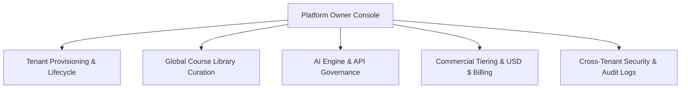

# LearnHub Platform Owner Guide

As a **Platform Owner**, you manage the core multi-tenant LearnHub infrastructure across all client organizations. This operational guide details how to provision new tenant organizations, manage global course offerings, oversee AI model services, configure commercial pricing in **US Dollars ($)**, and monitor cross-tenant analytics.

---

## 🌐 Platform Owner Architecture & Navigation

Access the platform owner console at `/platform`.



```html
<div align="center">
  
  <p><em>Figure 1: Platform Owner Console displaying active tenants, aggregate active learners, and system health.</em></p>
</div>
```

---

## 🏢 Tenant Organization Provisioning

Create and onboard new client organizations under `/platform/organizations`.

### Provisioning Steps:
1. Click **Provision New Organization**.
2. Enter the **Organization Name** and unique **URL Slug** (e.g., `acme-corp`).
3. Set initial **Organization Admin Email**.
4. Select Subscription Tier (e.g., **Professional $499/mo** or **Enterprise $1,499/mo** in USD).
5. Configure **Global Library Access**: Enable or disable tenant access to copy master courses from the global repository.
6. Click **Create Tenant**. LearnHub provisions the database tenant boundaries, sends an initial admin invitation, and initializes default catalog settings.

---

## 📚 Global Course Library Curation

Maintain master courses available to all subscriber organizations under `/platform/library`.

```html
<div align="center">
  <video width="800" controls poster="https://images.unsplash.com/photo-1516321318423-f06f85e504b3?w=1000&auto=format&fit=crop&q=80">
    <source src="https://commondatastorage.googleapis.com/gtv-videos-bucket/sample/Sintel.mp4" type="video/mp4">
    Your browser does not support the video tag.
  </video>
  <p><em>Video 1: Curation and Publishing of Global Library Courses (2 mins).</em></p>
</div>
```

- **Publish Master Courses**: Author high-quality compliance or skill courses and mark them as `GLOBAL_LIBRARY_PUBLISHED`.
- **Version Updates**: Push updates to master global courses. Subscriber tenant admins can review diffs before updating their copied local course versions.

---

## 🤖 AI Superpower Services & Model Governance

Manage LearnHub's AI subsystem integrations under `/platform/ai`.

- **Mux & Whisper Integration**: Monitor automated speech-to-text transcript processing pipelines.
- **AI Quiz Generation Limits**: Configure rate limits and model token usage for auto-quiz generation.
- **AI Recommendation Tuning**: Adjust category/tag weightings for AI recommended courses across tenant catalogs.

---

## 💰 Commercial Pricing & Tier Management (USD $)

Configure default billing rules, per-user pricing, and subscription packages. All rates are defined strictly in **US Dollars ($)**.

```html
<div align="center">
  
  <p><em>Figure 2: Platform Commercial Billing Tier Management in USD ($).</em></p>
</div>
```

| Plan Key | Monthly Price (USD $) | Included Seat Cap | Overage Rate (USD $) |
| :--- | :--- | :--- | :--- |
| `STARTER` | **$19 / user / mo** | 25 Users | $25 / user / mo |
| `PRO` | **$499 / mo** | 100 Users | $5 / user / mo |
| `ENTERPRISE` | **$1,499 / mo** | 500 Users | $2 / user / mo |

---

## 🔒 Security, Audit & Compliance Monitoring

Review system-wide audit logs under `/platform/audit`.

- **Cross-Tenant Event Logs**: Monitor admin logins, tenant setting changes, user imports, and data exports.
- **System Metrics**: Track API latency, database connection health, HLS video stream delivery, and email delivery rates.

For user guides covering specific roles, view the [Learner Guide](learner-guide.md), [Admin Guide](admin-guide.md), or return to the main [README.md](../../README.md).
